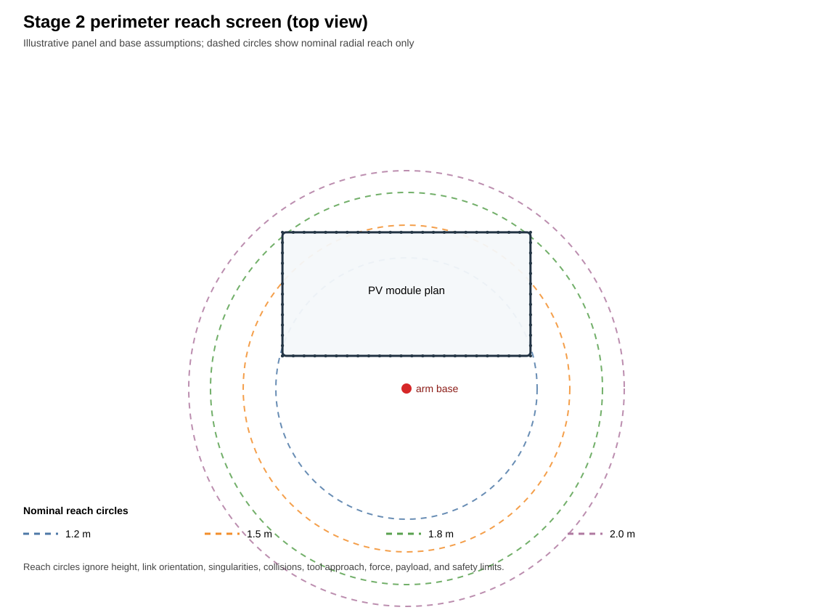

# Stage 2 robotic workcell reach screen

**Run ID:** S2-REACH-20261119-01  
**Execution:** Python 3.14.10 standard library  
**Status:** executed geometric screen; not validated robot motion.

## Question
Can one stationary arm base geometrically reach sampled perimeter task points on an illustrative module from one long-side work position, and how much reach is needed?

## Model and assumptions

- Rectangular panel: 2278 × 1134 mm, centered at (0, 0); these are scenario dimensions, not an AGASTYA-measured panel.
- Arm base projection: (0, -867) mm; 300 mm beyond the near long edge.
- Perimeter task points: 71 sampled at no more than 100 mm spacing, including all four corners.
- Reachability rule: planar Euclidean distance from base projection ≤ scalar nominal reach.
- No kinematic, payload, force, collision, speed, cycle-time, sensor, or safety assumptions are encoded.

## Results

- Maximum sampled base-to-perimeter radius: **1831.3 mm**.
- Reach required to include all sampled points under this planar rule: **1831.3 mm**.
- 95th-percentile sampled radius (nearest-rank): **1771.4 mm**.

| Nominal radial reach | Sampled points within radius |
|---:|---:|
| 1200 mm | 25/71 (35.21%) |
| 1500 mm | 47/71 (66.20%) |
| 1800 mm | 69/71 (97.18%) |
| 2000 mm | 71/71 (100.00%) |

## Engineering interpretation

The screen shows whether a nominal radial reach is plainly too short for a single fixed-base perimeter tool path in this illustrative layout. If the required reach is impractical for payload, cost, stiffness, or guarding, a panel indexer or robot linear rail can reduce the required arm reach. That trade cannot be quantified until the actual module dimensions, station layout, tool approach directions, and fixture are measured.

Use the arm to position and control task-specific tools while the module remains supported by a fixture. The arm should not be assumed to lift the complete module. Frame release and junction-box/cable removal likely need different tools and access orientations; a quick tool changer or separate dedicated actuator must be compared against one tool doing both. No actuator, robot model, joint configuration, or payload rating is selected here.

## Limits and next input

This is a reproducible 2D reach screen. It does not prove inverse-kinematic reachability, tool orientation, collision clearance, structural rigidity, repeatability, frame release forces, cycle time, or safety. Replace the scenario dimensions with measured target-module dimensions, then build a 3D CAD/workcell model and evaluate manufacturer robot data before choosing an arm. Measure frame-release and junction-box removal forces on approved representative material before actuator sizing.

Outputs: `perimeter_task_points.csv`, `reach_screen_summary.json`, and `reach_envelope.svg`.
