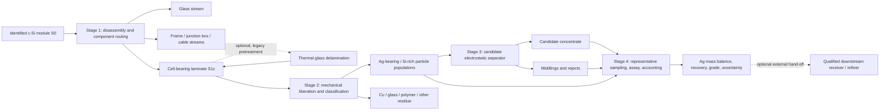

# Four-stage process model

**Basis:** current Phase A charter and architecture crosswalk. Stream IDs below are proposed tracking labels; no physical AGASTYA streams have been recorded.

## Stage interfaces

| Stage | Feed and starting state | Operation / governing effects | Planned outputs | Unknowns and measurements required |
|---|---|---|---|---|
| **1 — Disassembly and component routing** | One identified module; current design scope is crystalline silicon (c-Si). Actual sample, technology, dimensions, condition, mass, and bill of materials are unknown. | Identify and route frame, junction box/cables, front glass, and cell-bearing laminate. Manual removal is the current charter concept. Scale readings and documented losses define the first balance; no validated automation or force model exists. | S1a glass; S1b frame/hardware; S1c cell-bearing laminate; S1d documented debris/losses. | Panel maker/model/year, mono/multi and cell architecture, glass/backsheet construction, intact/tare masses, output masses, instrument checks, photos, parent-child IDs, and Ag assays where partition claims are needed. |
| **2 — Mechanical liberation and classification** | S1c or a deliberately defined pretreated equivalent. Silver contacts may remain attached to silicon; ribbons may carry Cu and coatings. No AGASTYA particle lot or measured particle-size distribution is recorded. | Contained mechanical size reduction and screening/classification are candidates. Breakage, composite fracture, size partition, particle shape, and liberation are distinct phenomena. A sieve predicts a size split only; it does not identify Ag or prove contact liberation. | S2a size classes and any characterized Ag-bearing particles; S2b Si-rich particles; S2c Cu/glass/polymer/other fractions; documented losses. | Equipment and settings, PSD by mass, particle shape/density/moisture, material class, Ag association/liberation by suitable microscopy/elemental methods, all output masses, dust capture, and assay data. |
| **3 — Electrostatic separation candidate** | A Stage 2 particle feed shown to satisfy the separator's accepted size/shape and moisture range. Current geometry, feed, and property distributions are unknown. | In corona/roll separators, charging, electrical conductivity/charge decay, induced charge, gravity, roll/contact forces, particle trajectory, humidity, and possible sparks interact. Ag-bearing cell fragments can co-separate with Al/Cu/Si; elemental silver selectivity is not assured. | S3a candidate enriched fraction; S3b middlings; S3c rejects; each fully weighed and assayed. | Dimensioned electrodes/roll/splitter, voltage/polarity, speed, feed rate, field map, size/shape/conductivity/charge distributions, humidity, sparks, power, bin masses, assay by stream, replicate uncertainty. No current AGASTYA separator is modeled or tested. |
| **4 — Sampling, assay, and accounting** | Representative feed, concentrate, middlings, rejects, and other losses from a defined physical run. None exists in the project record. | Register, homogenize/split samples, use a matrix-validated lab assay, compute total and Ag balances, uncertainty, and separate performance metrics. XRF screening is not chemical-phase identification; solution ICP requires validated sample preparation/digestion. | Auditable mass and Ag balances, mass yield, Ag grade, stage/overall Ag recovery, balance residual, uncertainty, and retained samples. The output is data and a silver-bearing fraction, not purified metal. | Lab acceptance, assay method, preparation, blanks/standards/duplicates, detection/quantification limits, uncertainty, aliquot mass, sample lineage, measured output masses and final-product definition. |

## Material scope and inventory boundaries

- The current process research is for **c-Si** modules. Cell metallization design and Ag loading vary by generation and architecture; the silver is printed contact metallization, commonly as narrow fingers/grid lines on the cell, with interconnect ribbons and other conductive materials also present. See the Nature Communications contact-formation study and the source-qualified evidence register.
- **CdTe, CIGS, perovskite, and other thin-film technologies are not interchangeable c-Si feeds.** The current project has no accepted thin-film process or composition model. Identify and segregate unknown/non-c-Si modules for a suitable qualified route; do not send them through this c-Si model by assumption.
- A review-derived 300 ppm case and a study-specific 600 g/t value are kept separate. At a normalized 1 kg basis they correspond to 0.300 g and 0.600 g Ag, respectively. A secondary 630 g/t wording corresponds to 0.630 g/kg but is unresolved. None is an AGASTYA assay or a statistical interval.
- Component mass fractions in `preliminary_material_inventory.csv` are a literature scenario with a 2.47% unassigned remainder, not a universal module recipe. Real frame, glass, encapsulant, backsheet, ribbons, solder, and cell fractions depend on module construction.

## Optional thermal pretreatment and stage-number conflict

Legacy thermal documents describe hot-knife glass/laminate separation and a proposed heated roller. The current crosswalk places this as an **optional upstream pretreatment between Stages 1 and 2**, not as current Stage 3. Glass delamination does not establish EVA removal from cells, Ag recovery, or clean Ag-bearing particles. The workbook's energy calculation assumes uniform heating of all EVA and a 2.2 multiplier; both are design assumptions. No thermal trial exists.

## Metric definitions

For a measured feed with mass `M_f` and Ag mass fraction `x_Ag,f`, feed Ag is `m_Ag,f = M_f x_Ag,f`.

- **Mass yield** = target stream mass / stage feed mass.
- **Ag grade** = Ag mass in target stream / total target stream mass.
- **Ag recovery** = Ag mass in target stream / Ag mass entering the stage.
- **Enrichment factor** = target product Ag grade / feed Ag grade.
- **Total mass residual** = input mass − all measured output masses − documented losses.
- **Ag residual** = Ag in feed − Ag in all assayed output streams − documented Ag losses.

Concentration, mass yield, recovery, enrichment, purity, and balance closure are different quantities. A concentrate is not silver metal.

## Dependency map

`module technology and measured mass/composition → Stage 1 component masses and Ag partition → Stage 2 PSD/shape/liberation/Ag association → Stage 3 charge and trajectory response by particle class → Stage 4 representative assays and reconciled balances → qualified downstream acceptance/refining outside the current boundary`.

Unknown inputs must stay unknown through downstream calculations. Do not replace a missing stage yield with an assumed efficiency or force the overall balance to close.
