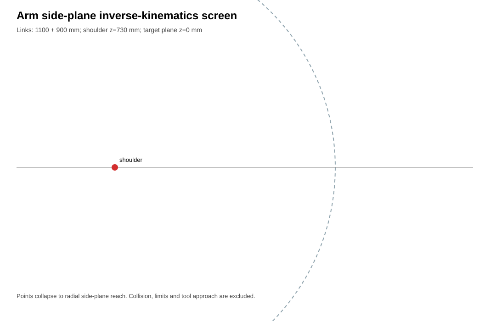

# Stage 2 inverse-kinematics and payload screen

**Run:** S2-3D-PLANAR-IK-2026-11-20-01 
**Evidence:** simulated from concept dimensions; not experimentally validated.

## Result

- Reachable perimeter points: **71/71 (100%)**.
- Maximum shoulder-to-target distance: **1971.44 mm**.
- Maximum FK closure error: **2.5421e-13 mm**.

Two-link IK uses cos(q2)=(d^2-L1^2-L2^2)/(2 L1 L2); both elbow branches are solved and the branch with minimum absolute pitch sum is retained. The wrist pitch cancels shoulder-plus-elbow pitch for a nominal horizontal tool.

## Limits

The points and base location are illustrative. Unlimited joint travel, free yaw and a rigid ideal chain are assumed. There are no collision, link mass, tool, actuator, speed, structural, force, duty-cycle or safety models. Replace the panel and tool assumptions and obtain manufacturer data before considering a guarded physical build.
